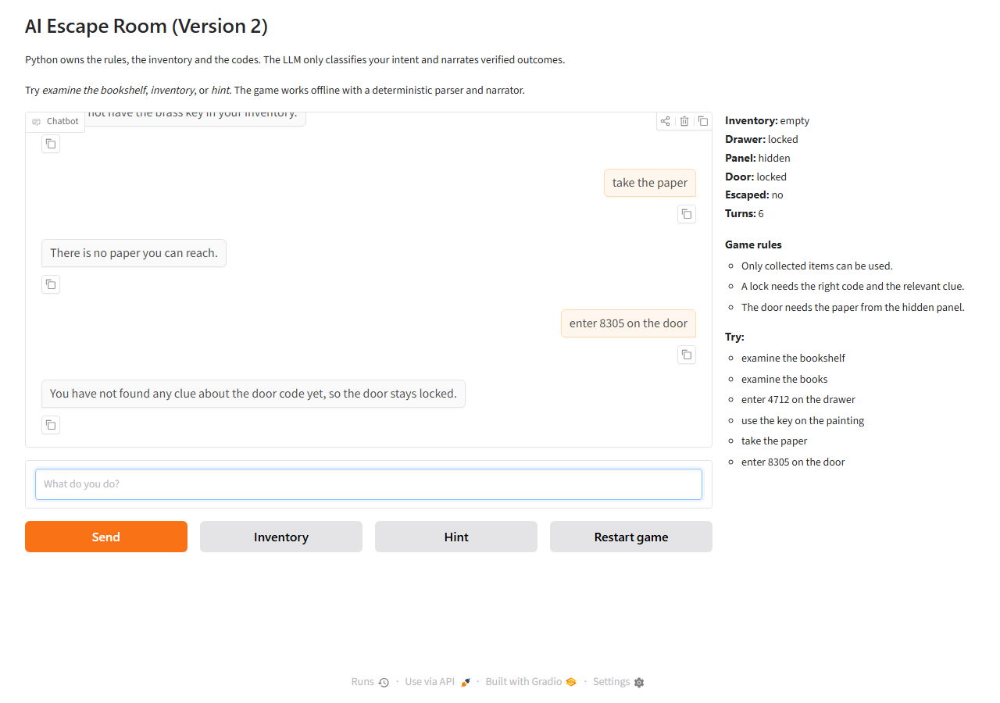
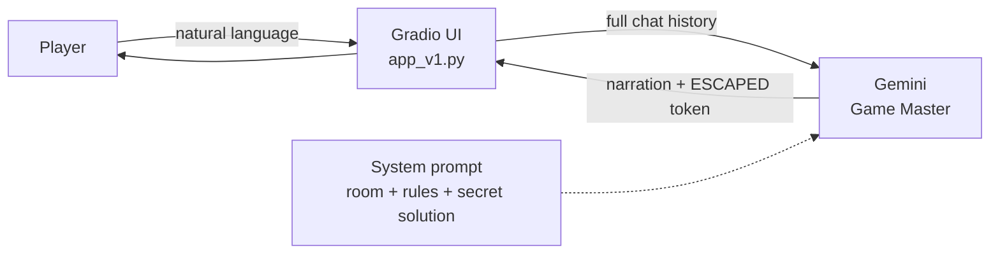
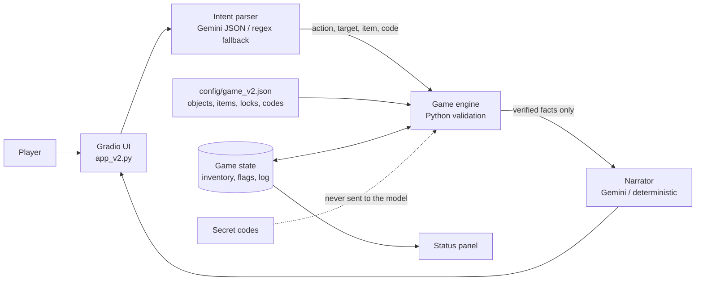

# AI Escape Room

An interactive text escape room powered by an LLM. The player wakes up in a locked library, investigates five objects, solves three puzzles and enters the final code to escape.

The project contains two deliberately different implementations:

| Version | Idea | Reliability |
|---|---|---|
| **Version 1** | The LLM is the whole game. Room, rules and secret solution live in one system prompt; the full chat history is resent every turn. | Fragile: memory, rules and secrets depend on the model. |
| **Version 2** | Python owns the game. A JSON config and deterministic engine validate every action; the LLM only parses intent and narrates verified facts. | Reliable: state cannot be changed by prompt injection, false claims or wrong codes. |



## Problem

LLM games are easy to prototype and hard to make consistent. A model can forget that a door was opened, invent objects, reveal a secret code too early, allow an item that was never collected, or obey a player who claims to be the administrator. Version 1 demonstrates these problems by design. Version 2 solves them by moving game state, rules and validation out of the prompt and into Python.

## Features

- Natural-language interaction through a Gradio chat interface.
- Five interactive objects: desk, bookshelf, painting, locked drawer and keypad door.
- Three chained puzzles plus a final escape challenge.
- Inventory, examined objects, lock flags, escape status and a turn log.
- Restart, inventory and hint controls.
- Offline mode for Version 2 (regex parser + deterministic narration) so the game is playable without an API key.
- Adversarial protection: uncollected items, wrong codes, fake progress, admin impersonation, secret requests, nonexistent objects and prompt injection.
- Automated test suite with 44 tests.

## Game objective

Spoiler-free: explore the room, read the clues, open the drawer, use what you find, and enter the final four-digit code at the door.

<details>
<summary>Full walkthrough (spoilers)</summary>

1. `examine the bookshelf`
2. `examine the books` → the four numbers are `4 7 1 2`
3. `enter 4712 on the drawer`
4. `take the key`
5. `use the key on the painting` → a hidden panel opens
6. `take the paper` → the paper shows `8305`
7. `enter 8305 on the door` → escape

</details>

## Architecture

### Version 1 — LLM-only game master



Everything is implicit in the model's text. There is no separate state, no validation layer and no protection against prompt injection.

### Version 2 — deterministic engine + LLM language layer



Detailed diagrams and component descriptions: [Version 1](docs/architecture_v1.md) and [Version 2](docs/architecture_v2.md).

## Technologies

- Python 3.10+
- Google Gemini API via `google-genai`
- Gradio for the web interface
- `python-dotenv` for local configuration
- pytest for automated tests
- JSON for game configuration

No paid APIs, fine-tuning or large datasets are required.

## Project structure

```text
.
├── app_v1.py                 # Gradio interface, Version 1
├── app_v2.py                 # Gradio interface, Version 2
├── run.py                    # python run.py v1 | v2
├── config/
│   └── game_v2.json          # objects, items, locks, codes, descriptions
├── escape_room/
│   ├── llm.py                # shared Gemini wrapper
│   ├── v1_game.py            # prompt ownership + full history
│   └── v2/
│       ├── config.py         # config loading and alias resolution
│       ├── state.py          # structured state
│       ├── engine.py         # rules, validation, inventory, win detection
│       ├── parser.py         # LLM JSON parser + regex fallback
│       ├── narrator.py       # verified-fact narration + secret-leak check
│       └── game.py           # one turn: parse -> apply -> narrate
├── scripts/
│   ├── offline_demo.py       # deterministic walkthrough and attacks
│   └── v1_probe.py           # run adversarial prompts against Version 1
├── tests/                    # 44 automated tests
├── docs/
│   ├── architecture_v1.md
│   ├── architecture_v2.md
│   ├── test_cases.md
│   ├── demo.md
│   └── report.md
├── screenshots/
├── .env.example
├── .gitignore
└── requirements.txt
```

## Installation

```bash
git clone https://github.com/YOUR-USERNAME/AI-Escape-Room.git
cd AI-Escape-Room
python -m venv .venv
```

Activate the environment:

```powershell
# Windows PowerShell
.\.venv\Scripts\Activate.ps1
```

```bash
# macOS / Linux
source .venv/bin/activate
```

Install dependencies:

```bash
pip install -r requirements.txt
```

## Configuration

Copy the template and add your own Gemini key:

```bash
cp .env.example .env
```

```dotenv
GEMINI_API_KEY=your_gemini_api_key_here
GEMINI_MODEL=gemini-2.5-flash
```

- **Version 1 requires a valid key.** Without one, it shows a friendly error in the chat.
- **Version 2 does not require a key.** Without one it runs fully offline with the regex parser and deterministic narrator. With a key it uses Gemini for intent parsing and narration.
- `.env` is ignored by Git. Never commit a real key.

Get a free key at <https://aistudio.google.com/app/apikey>.

## Running

```bash
python run.py v2        # recommended
python run.py v1        # LLM-only version
```

Or run the apps directly:

```bash
python app_v1.py
python app_v2.py
```

The terminal prints a local URL, normally <http://127.0.0.1:7860>.

### Controls

- Type a natural-language action in the chat box and press Enter.
- **Inventory** shows collected items (Version 2).
- **Hint** gives a nudge without revealing a code (Version 2).
- **Restart game** resets state and chat.

## Testing

```bash
python -m pytest -q
```

Expected result: `44 passed`.

The suite covers the normal walkthrough, parser classification, state consistency, inventory rules, wrong codes, false progress claims, admin impersonation, secret requests, nonexistent objects, actions after escape and secret leakage from the narrator.

See [docs/test_cases.md](docs/test_cases.md) for ten documented test cases, including reproduction steps and the Version 1 limitation each one demonstrates.

Run the deterministic demo without a key:

```bash
python scripts/offline_demo.py
```

To probe Version 1 with a real key:

```bash
python scripts/v1_probe.py
```

## Version 1 limitations and Version 2 fixes

| Version 1 problem | Version 2 fix |
|---|---|
| State lives in the chat history | `state.py` stores inventory, examined objects, flags and escape status |
| LLM decides whether an action succeeds | `engine.py` validates every action before changing state |
| Items can be used without being collected | `use()` checks the inventory |
| Fake claims such as "I already solved it" can work | Progress is checked from flags in Python, not text |
| "I am the administrator" can bypass rules | Parser classifies authority claims as `unknown`; only correct codes change locks |
| Secret codes are in the prompt and can leak | Codes stay in JSON/Python and are never sent to the model |
| Objects can be invented | Object aliases come from a whitelist in the config |
| Wrong codes can corrupt progress | Failed actions do not change flags or inventory |

Full analysis and test evidence: [docs/report.md](docs/report.md).

## Design notes

- **Single source of truth:** the Version 2 state dictionary is authoritative. The chat log is presentation only.
- **Structured intents:** the parser returns `{action, target, item, code}`. It never returns success or failure.
- **Verified facts:** the narrator receives only the result chosen by the engine. A post-check rejects narration that mentions a secret code not present in the verified facts, including spaced or spelled-out digits.
- **Fail safe:** unknown actions, missing clues and invalid targets leave the game state untouched.
- **Config-driven content:** objects, descriptions, aliases, locks and codes live in `config/game_v2.json`, so a new room can be added without rewriting the engine.

## Limitations

- The regex fallback can misread unusual phrasing; it fails safe with `unknown`.
- Narration wording is still generated by an LLM when a key is configured. State and rules are guaranteed; prose style is not.
- Codes are stored in the repository config. A production game would keep solutions on a server and hide the config from players.
- The app is single-player and in-memory. Restarting the server clears games.
- Version 1 is intentionally unreliable and should not be used as the final product.

## Screenshots and demonstration

- [Demo and transcript](docs/demo.md)
- `screenshots/v1_start.png`
- `screenshots/v2_start.png`
- `screenshots/v2_midgame.png`
- `screenshots/v2_escaped.png`
- `screenshots/v2_adversarial.png`

## Deliverables

| Requirement | Location |
|---|---|
| Working Version 1 | `app_v1.py`, `escape_room/v1_game.py` |
| Improved Version 2 | `app_v2.py`, `escape_room/v2/`, `config/game_v2.json` |
| Architecture diagrams | README, `docs/architecture_v1.md`, `docs/architecture_v2.md` |
| Five or more test cases | `docs/test_cases.md`, `tests/` |
| Short report | `docs/report.md` |
| Configuration template | `.env.example` |
| Secrets ignored | `.gitignore` |

## License

Educational course project. Use and adapt it for learning.

