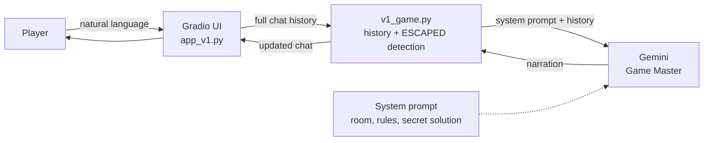
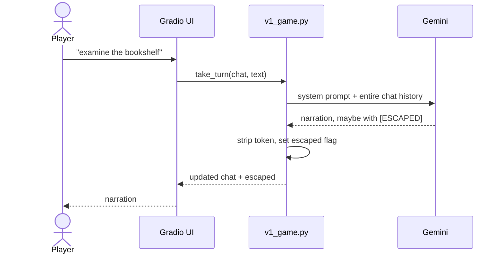

# Architecture — Version 1

Version 1 treats the LLM as the game master, the rule engine, the memory and the narrator. The room description, the three puzzles and the secret solution are all in one system prompt.

## Components

| Component | File | Responsibility |
|---|---|---|
| Gradio interface | `app_v1.py` | Chat input, chat history, restart button and status message. |
| Game loop | `escape_room/v1_game.py` | Appends player messages, converts history to Gemini turns, detects `[ESCAPED]`. |
| Gemini client | `escape_room/llm.py` | Sends the system prompt and full chat history to the model. |
| System prompt | `SYSTEM_PROMPT` in `v1_game.py` | Contains the room, rules and complete solution. |

## Component diagram

## Turn sequence

## What works

- Fast to build and easy to change the story.
- Natural language feels flexible.
- The model can improvise descriptions and hints.

## Why it is unreliable

| Weakness | Consequence |
|---|---|
| No structured state | The model can forget an opened drawer or contradict an earlier action. |
| Rules are prompt text | A persuasive player can talk the model out of the rules. |
| Solution is in the prompt | The model may reveal codes early or accept a correct code before the puzzles are solved. |
| No inventory check | The model may let the player use a key that was never collected. |
| No object whitelist | The model may invent a chandelier, a safe or a second door. |
| Escape is a magic token | Detection depends on the model remembering to emit `[ESCAPED]`. |
| Long history | Important facts get diluted as the conversation grows. |

These weaknesses are intentional: Version 1 is the baseline that Version 2 improves. See `docs/test_cases.md` and `scripts/v1_probe.py` for reproduction steps.
