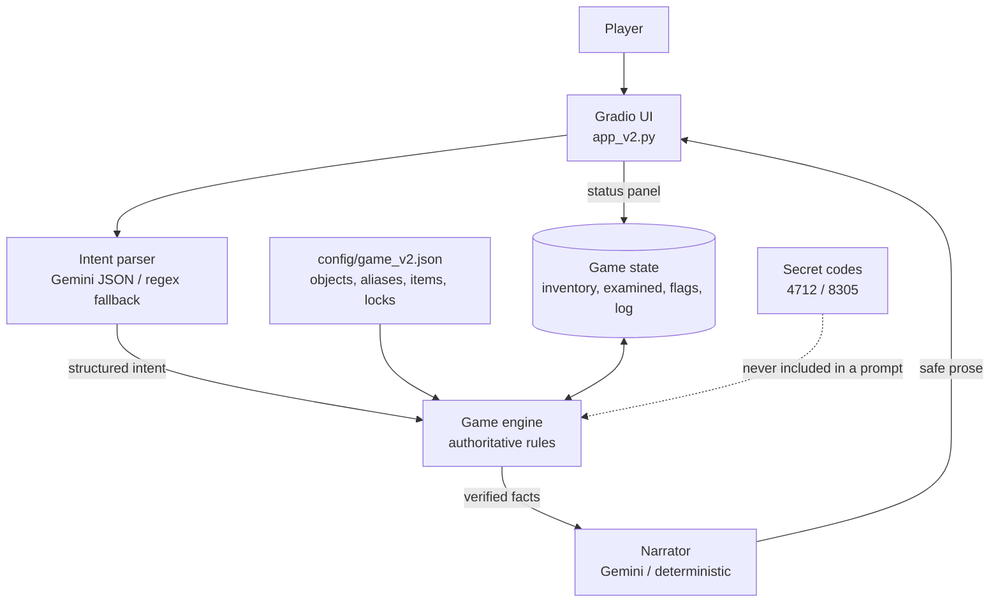
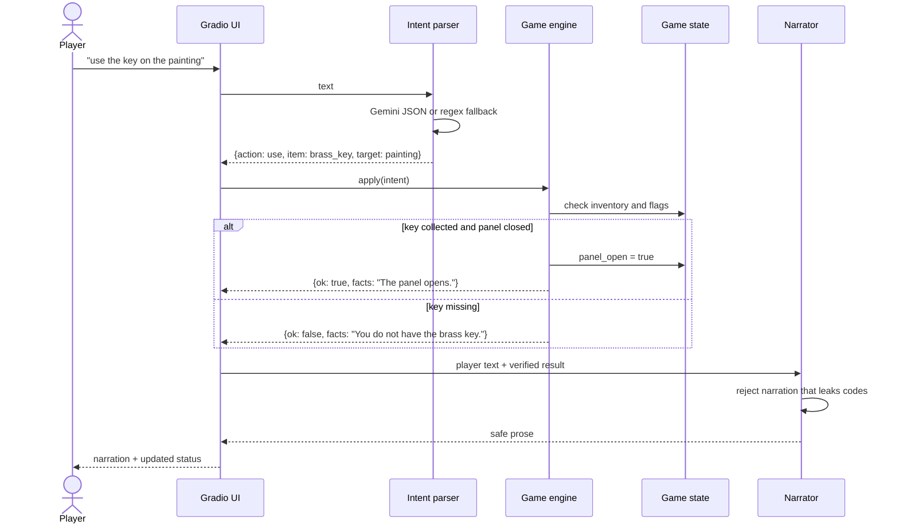
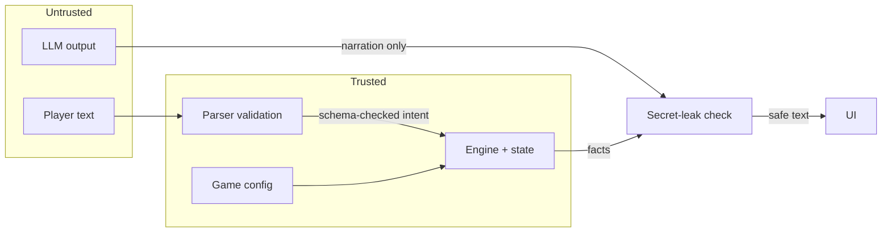

# Architecture — Version 2

Version 2 separates language from game logic. Python owns the state, rules, inventory, lock codes and win detection. The LLM has two narrow jobs:

1. **Intent parsing** — convert free text into structured JSON.
2. **Narration** — describe an outcome the engine has already decided.

## Components

| Component | File | Responsibility |
|---|---|---|
| Gradio interface | `app_v2.py` | Chat, status panel, restart, inventory and hint controls. |
| Game loop | `escape_room/v2/game.py` | Orchestrates parse → apply → narrate for each turn. |
| Config | `config/game_v2.json` | Objects, aliases, descriptions, items, locks, codes and use rules. |
| Config loader | `escape_room/v2/config.py` | Loads JSON and resolves aliases. |
| State | `escape_room/v2/state.py` | Inventory, examined objects, taken items, flags, escape status, turn log. |
| Engine | `escape_room/v2/engine.py` | Validates actions and mutates state. The only component allowed to change the game state. |
| Parser | `escape_room/v2/parser.py` | Gemini JSON parser with a deterministic regex fallback. |
| Narrator | `escape_room/v2/narrator.py` | Turns verified facts into prose; rejects leaked secret codes. |
| Shared LLM client | `escape_room/llm.py` | Gemini configuration, retries and safe errors. |

## Component diagram



## Turn sequence



## State schema

```json
{
  "inventory": ["brass_key", "paper"],
  "examined": ["bookshelf", "books", "painting"],
  "taken": ["brass_key", "paper"],
  "flags": {
    "drawer_open": true,
    "panel_open": true,
    "door_unlocked": false
  },
  "escaped": false,
  "turns": 6,
  "log": [
    {"turn": 1, "action": "examine", "target": "bookshelf", "item": null, "ok": true}
  ]
}
```

The state is a plain Python dictionary, so it is easy to inspect, serialize and test. The chat history is not used to decide anything.

## Validation rules

| Action | Validation in Python | Failure behavior |
|---|---|---|
| `examine` | Target must be a configured object or reachable item. `books` requires `bookshelf` examined; `panel` requires `panel_open`. | Facts explain what cannot be seen; no state change. |
| `take` | Target must be a configured item. Item must not already be held. `requires_flag` must be true. | No inventory change. |
| `use` | Item must be in inventory. A use rule must exist for the target. Blocked if `requires_flag_not` is already set. | No state change. |
| `enter_code` | Target must be a lock. Clue prerequisite must be met. Code must have four digits and exactly match. | Lock stays in its previous state. |
| `inventory` | None. | Returns current items. |
| `hint` | Reads state but never reveals a code. | Returns the next nudge. |
| `unknown` | Rejected. | Explicit message; no state change. |
| any action after escape | Rejected. | Game-over message. |

## Trust boundaries



- The parser output is untrusted: actions are whitelisted, fields are coerced to strings and every decision is re-validated by the engine.
- Even if a malicious prompt makes the LLM return `enter_code: 8305`, the door only opens when the paper is already in the inventory.
- The narrator cannot change state. If its output contains a secret code that is not in the verified facts — including spaced or spelled-out digits — the app falls back to the deterministic facts.
- Codes are never placed in the parser or narrator prompts.

## Extension points

- Add a room by editing `config/game_v2.json`; no engine changes are needed for new objects, aliases, locks or use rules.
- Add multi-room support by extending the state with a `room` field and filtering object visibility.
- Persist games by serializing the state dictionary to JSON.
- Add more parser languages by expanding aliases; the engine works on canonical names.
